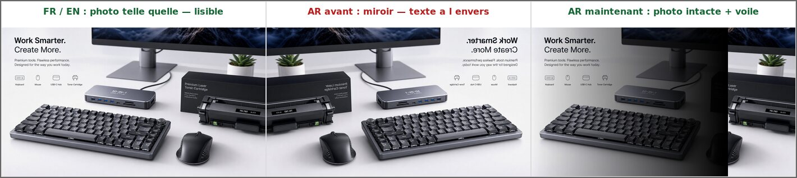

# Bannières : le texte des photos n'est plus inversé en arabe — validation

Demande traitée : « à propos des images de la bannière principale, est-ce qu'on
peut contourner le problème de l'écriture inversée dans la version arabe ? »

Contrôle automatique : `npm run test:banners`
(`tests/banner-arabic-photo.test.tsx`, 9 tests).

## 1. Le défaut

En version arabe, `bannerImageClass()` retournait **toute** photo de bannière
avec `-scale-x-100` : le miroir était décidé par la langue seule. Utile pour une
photo composée en LTR (sujet à gauche, zone calme à droite) dont on veut
ramener la zone calme sous le texte arabe, il devenait destructeur dès que la
photo contient de l'écriture imprimée — un cas très fréquent sur ce catalogue
(accroche anglaise, logo de marque sur un produit, clavier QWERTY, étiquette de
cahier, titre écrit au tableau) :

*(de gauche à droite : la photo telle qu'elle est, ce que le miroir automatique
en faisait en arabe, et le résultat désormais — photo intacte, voile sombre
rabattu à droite sous le texte arabe.)*

Le texte n'est pas « traduit » ni « re-généré » : il est **lu dans la photo**.
Aucun CSS ne peut le remettre à l'endroit sans repasser la photo en miroir — sauf
à faire tourner une reconnaissance de texte dans le navigateur, ce qui n'est ni
fiable (aucune des photos du catalogue ne pourrait être analysée sans OCR) ni
sans risque (une détection ratée retourne une photo correcte).

## 2. Le correctif : le miroir devient un choix, bannière par bannière

- **La photo n'est plus jamais retournée automatiquement.**
  `bannerImageClass()` est remplacée par `bannerImageFrameClass(lang,
  mirrorInArabic)` (`src/lib/i18n-themes.ts`) : le miroir n'apparaît que si
  `mirrorInArabic` vaut `true` **et** que la langue est l'arabe. Absent (cas de
  tout le contenu existant, aucune migration de base nécessaire), il vaut
  `false` → la photo reste telle quelle et son texte reste lisible.
- **Le réglage existe dans لوحة الإدارة**, sur les cinq familles de bannières :
  héros, bannière panoramique, carrousel médian, rangée du haut, grille
  articles (`AdminDashboardModal.tsx`, case « عكس الصورة في النسخة العربية »),
  avec une aide qui énonce la règle : à cocher uniquement pour une photo sans
  aucun texte, composée avec son sujet à gauche.
- **Le cadre porte le miroir, pas l'image.** Les bannières empilent déjà deux
  `transform` sur l'`` : l'animation Ken Burns du carrousel médian
  (`@keyframes kenburns-zoom`) et le zoom au survol
  (`group-hover:scale-[1.03]`). Comme ils écraseraient le miroir (et
  réciproquement), le retournement est posé sur le `
` qui enveloppe la photo : les trois effets se composent au lieu de
  s'annuler.
- **Le dégradé sombre reste côté texte** (`bannerScrimClass`) : en arabe, le
  texte de la bannière s'affiche à droite et le voile suit. Rien à changer.

## 3. Composer une bannière arabe sans texte inversé

| Cas | Réglage |
| --- | --- |
| Photo sans aucun texte, sujet à gauche | cocher « عكس الصورة في النسخة العربية » |
| Photo avec texte imprimé (accroche, logo, clavier, cahier) | ne rien cocher — la photo reste lisible |
| Photo déjà retournée à la main avant l'envoi | la renvoyer dans son sens d'origine, puis ne rien cocher |

Les bannières acceptent déjà un texte d'accroche bilingue (شارة / عنوان / زر) :
la façon la plus sûre de faire une bannière arabe lisible est de partir d'une
photo **sans texte**, et de laisser l'accroche arabe à ces champs-là.

## 4. Ce qui est verrouillé par les tests

`tests/banner-arabic-photo.test.tsx` :

1. `bannerImageFrameClass` ne retourne rien sans `mirrorInArabic: true`, et
   jamais en anglais ;
2. carrousel médian, rangée du haut et grille articles : aucune photo retournée
   en arabe par défaut, seule la bannière cochée l'est ;
3. le miroir reste sur le cadre (`
`),
   jamais sur l'`` qui porte `kenburns-bg` / `group-hover:scale-[1.03]` ;
4. `page.tsx` passe bien le drapeau de la bannière au héros et à la bannière
   panoramique, et ne contient plus aucun `-scale-x-100` en dur ;
5. les six photos de démarrage qui portent du texte imprimé ne sont jamais
   marquées « miroir » dans `INITIAL_STORE_SETTINGS` ;
6. les cinq éditeurs de l'admin exposent la case, l'état enregistré de chaque
   bannière la pilote, et l'aide existe en anglais **et** en arabe.
